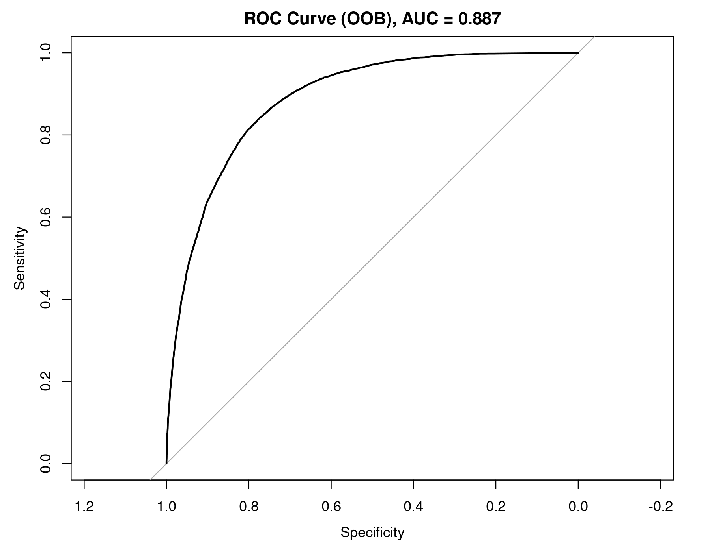
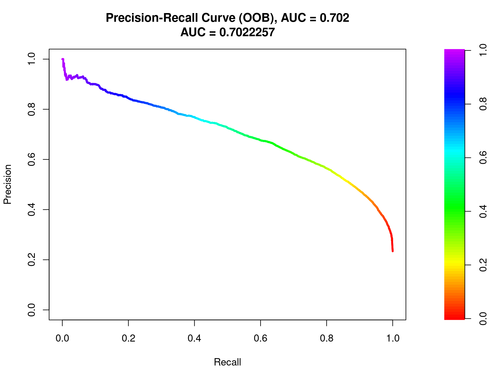

---
output: github_document
---

<!-- README.md is generated from README.Rmd. Please edit README.Rmd -->

```{r, include = FALSE}
knitr::opts_chunk$set(
  collapse = TRUE,
  comment = "#>",
  fig.path = "man/figures/README-",
  out.width = "100%"
)
```

# m6APrediction

## Overview

`m6APrediction` is an R package designed to predict N6-methyladenosine (m6A) modification sites using a trained Random Forest model.

The package provides two main functions:

- `prediction_multiple()`: predicts m6A modification probabilities and statuses for multiple RNA sequences.
- `prediction_single()`: predicts the m6A modification probability and status for a single input sequence.

The package uses sequence-related features, including GC content, RNA type, RNA region, exon length, distance to junction, evolutionary conservation, and DNA 5-mer sequence information.

## Installation

You can install the package from GitHub using `remotes`:

```{r, eval=FALSE}
install.packages("remotes")
remotes::install_github("YOUR_GITHUB_USERNAME/m6APrediction")
```

Replace `YOUR_GITHUB_USERNAME` with your actual GitHub username.

## Usage

### Load the package and example data

```{r}
library(m6APrediction)

model_path <- system.file(
  "extdata", "rf_fit.rds",
  package = "m6APrediction"
)

data_path <- system.file(
  "extdata", "m6A_input_example.csv",
  package = "m6APrediction"
)

model <- readRDS(model_path)
example_data <- read.csv(data_path)
```

### Multiple sequence prediction

Use `prediction_multiple()` to predict m6A modification sites for multiple input sequences.

```{r}
multiple_results <- prediction_multiple(
  ml_fit = model,
  feature_df = example_data
)

head(multiple_results)
```

The output contains the original input features, predicted m6A probabilities, and predicted m6A statuses.

### Single sequence prediction

Use `prediction_single()` to predict the m6A modification status of one sequence.

```{r}
single_result <- prediction_single(
  ml_fit = model,
  gc_content = example_data$gc_content[1],
  RNA_type = example_data$RNA_type[1],
  RNA_region = example_data$RNA_region[1],
  exon_length = example_data$exon_length[1],
  distance_to_junction = example_data$distance_to_junction[1],
  evolutionary_conservation = example_data$evolutionary_conservation[1],
  DNA_5mer = example_data$DNA_5mer[1]
)

single_result
```

## Model and Data

The package includes a pre-trained Random Forest model (`rf_fit.rds`) and an example input dataset (`m6A_input_example.csv`) in the `inst/extdata` directory.

## Evaluation

## Model Evaluation

The model was evaluated using out-of-bag (OOB) predictions generated by the random forest model.

- **ROC-AUC:** 0.8873
- **PRC-AUC:** 0.7022

The ROC curve illustrates the model's ability to distinguish between positive and negative m6A sites, while the precision-recall curve shows the trade-off between precision and recall.

### ROC Curve



### Precision-Recall Curve



